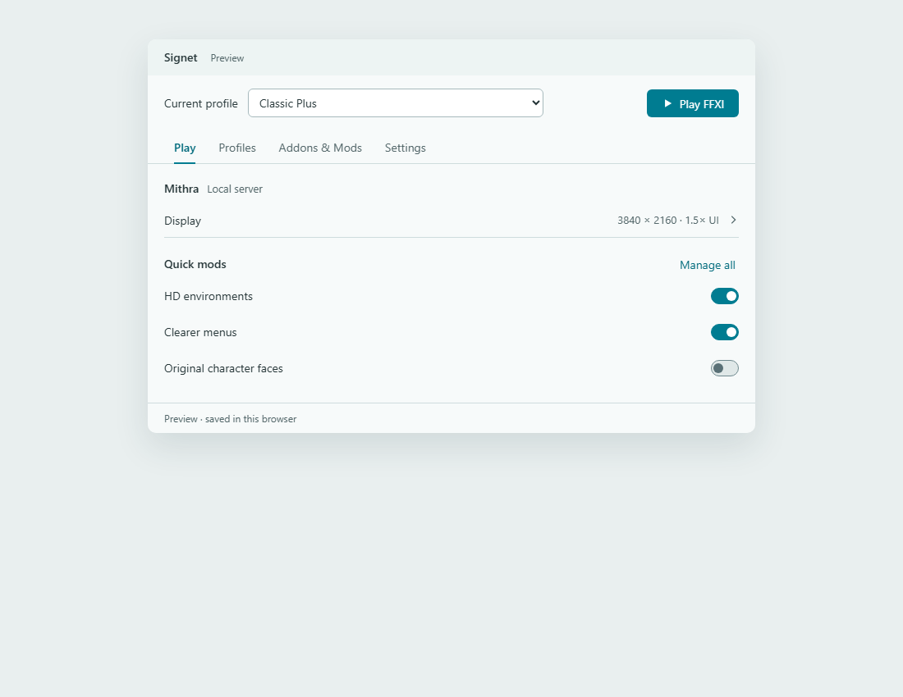
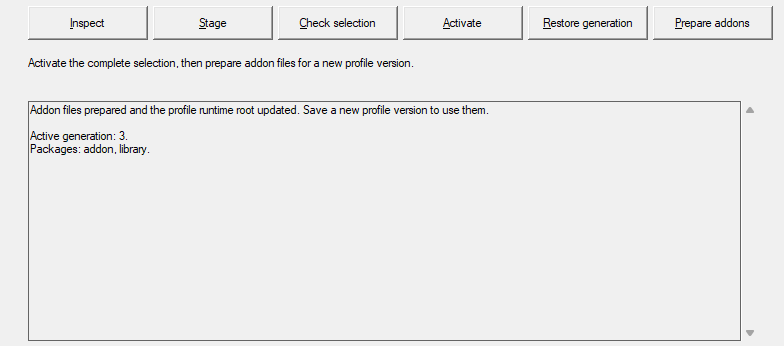

# Signet for FFXI

**Native builds and launch verification are paused pending security review.**
CI currently checks source policy only; its native build/test job is intentionally
disabled. See [the verification hold](docs/SECURITY_HOLD.md) before using the build
commands below. Play remains unavailable, and no binary release is provided.

An experimental Rust launcher and runtime for Final Fantasy XI, working toward
Windower and Ashita compatibility in one application.

**Early development, not a drop-in replacement.** The native GUI is a developer
workbench. A separate interactive player-interface preview now demonstrates
profiles, sample mod folders and readable settings in a compact frosted-white utility. Native integration, asset
overrides and graphics setup remain planned. The application is named Signet.



*Real browser capture of the working interface preview, using sample profiles
and settings. It does not launch or modify the game. See the
[player preview](ui/player-preview/README.md) for source and instructions.*

The native package workbench remains available:



*Real, cropped capture of the existing native package controls.*

## What currently works

- Rust launcher/runtime foundations, profile parsing and D3D8 forwarding.
- Selected Windower-style, Ashita-style and native Lua APIs.
- Separate Lua 5.1 and optional LuaJIT addon engines.
- File-based addon profiles, local module loading and typed lifecycle controls.
- Selected reload rollback, neighbor continuity and pending-work cancellation.
- Offline package staging, dependency checks, activation, restore and profile preparation.
- Synthetic fixtures for protocol, input, rendering and plugin boundaries.

A private local-server test campaign entered FFXI in four owned clients, verified
48 lifecycle requests and six server-confirmed addon commands, and closed its
clients and services normally. One case ran selected methods from eight original
Windower libraries with mixed Lua engines. This source export includes the
synthetic Rust fixtures, not private server databases, accounts, game assets,
third-party library snapshots or raw machine-specific reports. Public CI does
not reproduce the private-server campaign.

## Planned player experience

Profiles, a unified addon/plugin/mod library, readable configuration forms,
checkbox-based visual packs, conflict explanations, integrated verified graphics
setup, update checking and rollback. See [the roadmap](docs/ROADMAP.md).

## Build and test

Windows x86 is the primary runtime target. You need Rust/Cargo and Visual Studio
Build Tools with Desktop development with C++ and the Windows SDK. Development
has been checked with Rust 1.96.0; this is not a claim of minimum compiler support.

```powershell
rustup target add i686-pc-windows-msvc
cargo build --workspace --locked --target i686-pc-windows-msvc
cargo test --workspace --locked --target i686-pc-windows-msvc --features windower-runtime/game-thread-probe,windower-runtime/client-windowing,windower-runtime/isolated-probe
cargo test --locked --manifest-path providers/luajit/Cargo.toml --target i686-pc-windows-msvc
```

The optional LuaJIT provider uses its own workspace because its Lua engine
features cannot be unified with the Lua 5.1 runtime:

```powershell
cargo build --locked --manifest-path providers/luajit/Cargo.toml --target i686-pc-windows-msvc
```

The Rust fixtures run without FFXI or a server. Some diagnostic executables
require explicit local paths and optional features. See [development notes](docs/DEVELOPMENT.md).
Building is not an instruction to inject the runtime into an arbitrary client.

## Scope and limitations

- Arbitrary Windower/Ashita addons and native plugins are not yet supported.
- Native plugin ABI fixtures do not establish full native plugin hosting.
- Original Windower/Ashita cores are not the intended runtime backend.
- Graphics-provider probes do not establish a measured in-game FPS improvement.
- The native asset override manager, polished player UI and unattended updates are planned.
- The proprietary FFXI game remains 32-bit; a 64-bit conversion is outside current scope.
- Lua/native addon execution is not a security sandbox. Load only code you trust.

## Licensing and ownership

GPL-3.0-or-later; see [LICENSE](LICENSE) and [third-party notices](THIRD_PARTY_NOTICES.md).
Dependencies retain their own licenses. No FFXI assets, original runtime binaries,
third-party mod packages, server credentials or private databases are bundled.

An independent community project, not affiliated with or endorsed by Square Enix,
Windower or Ashita. FINAL FANTASY XI and other marks belong to their respective owners.
